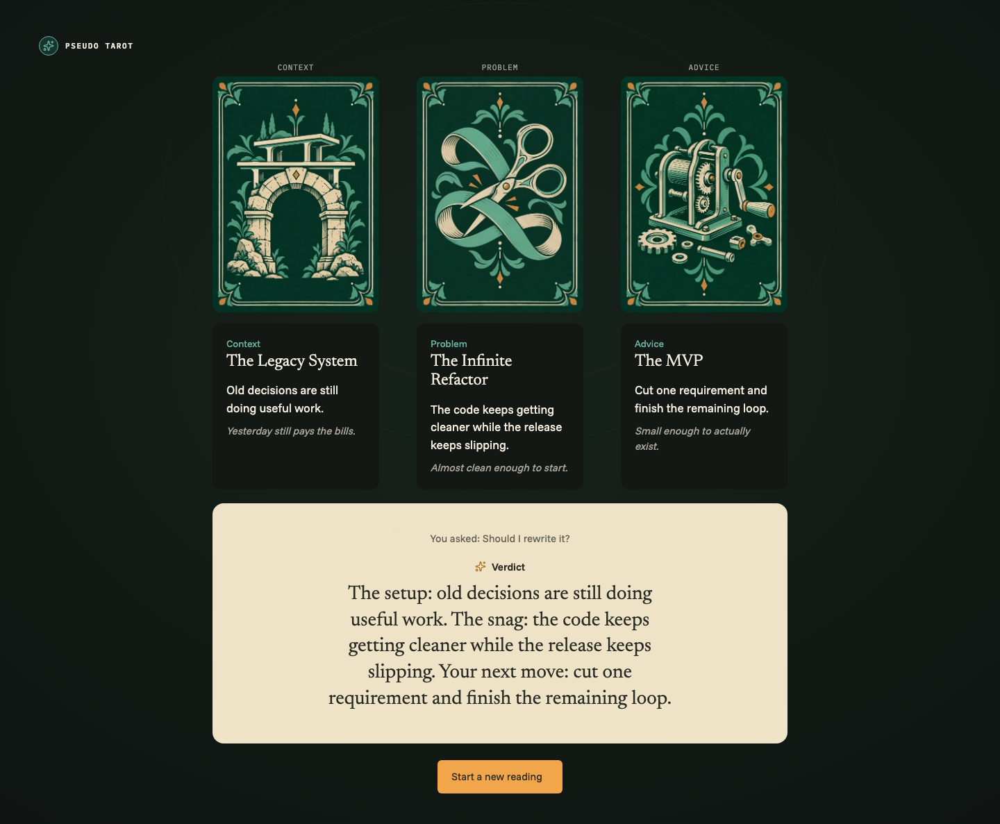
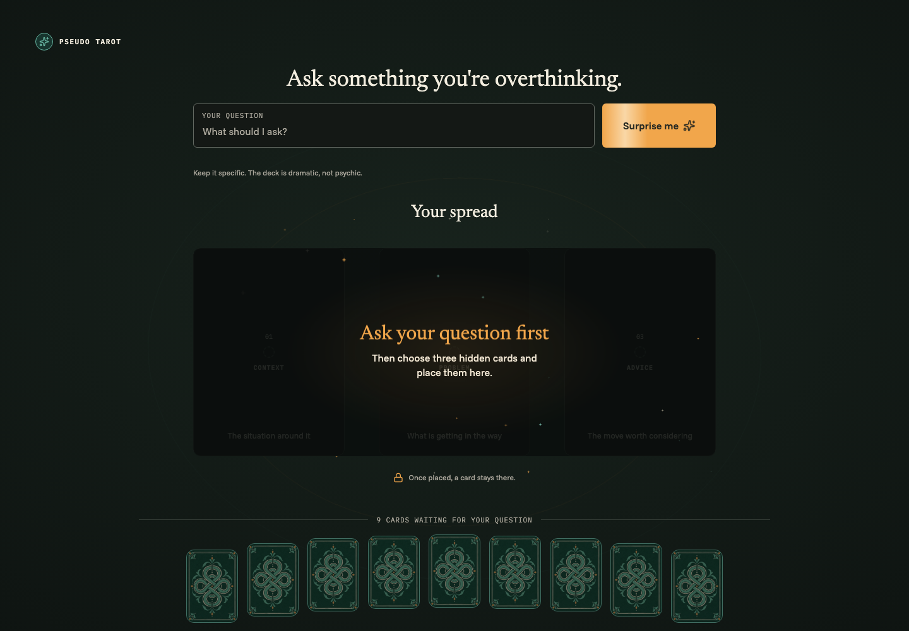

# Sortes — Pseudo Tarot

A tongue-in-cheek tarot reading for developers. Ask a question you're overthinking, place three
hidden cards, reveal them one by one, and get a verdict. The deck is dramatic, not psychic.

**Live:** <https://sortes.themkvz.com/>

Built as a small, complete product on [Remix 3](https://remix.run/) and Bun: server-rendered
pages, one interactive island, a pure domain layer, and browser tests. Useful as a reference for
anyone exploring Remix 3 beyond "hello world".



## Features

- **Three-card spread.** Context, Problem, and Advice positions, drawn from nine hidden choices
  out of a 16-card Developer Tarot deck (The Legacy System, Friday Deploy, Green CI, ...).
- **Ask or be surprised.** One primary button switches between `Ask` and `Surprise me`, which
  picks a prompt for you.
- **Drag, click, tap, or keyboard.** Drag a card into a slot with the mouse, or select and place
  it with click, tap, or keys. Reduced motion is respected.
- **Deterministic verdicts.** The same question and cards always give the same reading, in any
  pick or reveal order.
- **Shareable results.** A completed reading can be shared as a read-only link that works
  without JavaScript. Sharing always asks for confirmation first.
- **Survives a reload.** The reading in progress is restored from an encrypted session cookie.
  No accounts, no database, no analytics.
- **Original artwork.** 16 engraved card fronts and a shared card back, served as optimized
  WebP files.



## Architecture

`server.ts` validates the environment (`app/env.ts`) and passes each request to a Remix 3
router. Routes (`app/routes.ts`) map to one controller (`app/actions/controller.tsx`). Pages are
server-rendered with `remix/component` (JSX, not React).

| Area                       | What it does                                                                                                                                                       |
| -------------------------- | ------------------------------------------------------------------------------------------------------------------------------------------------------------------ |
| `app/domain/tarot/`        | Pure TypeScript, no UI or Node imports. The reading is a discriminated union state machine (`idle → choosing → ready → revealing → complete`) with pure transitions. |
| `app/actions/public/`      | The only browser island, `reading-board.tsx`. It holds board state and calls pure functions in `board-state.ts`. Mouse drag is one closure with one `AbortController`. |
| `app/reading-state/`       | Seals the reading in progress into one `HttpOnly` cookie with AES-256-GCM.                                                                                          |
| `app/middleware/`          | Security headers: CSP, HSTS, `nosniff`, referrer policy.                                                                                                            |
| `app/assets.ts`            | Remix asset server with an allow list. Fingerprinted URLs and minified scripts in production.                                                                       |

Notable decisions:

- **Mostly server-rendered.** Only the board is interactive. The home page, shared results, and
  error pages work without JavaScript.
- **Invalid moves are no-ops.** A transition that isn't allowed returns the same state object,
  so the UI can't reach an impossible state.
- **Deterministic interpretation.** An FNV-1a hash of the question and card pairs picks the
  verdict template. A pinned golden vector guards it in tests.
- **Share links carry data, not IDs.** `/r/:payload` is unpadded base64url JSON
  (`{ v: 1, d, s, q, c }`), size-limited and validated before use. Nothing is stored on the
  server. Shared pages send `no-store`, `no-referrer`, and `noindex`.
- **No styling or icon dependencies.** Co-located `css()` mixins, design tokens as CSS custom
  properties in `app/actions/document.tsx`, and inline lucide SVGs.
- **Specs before code.** Behavior is specified with [OpenSpec](https://github.com/Fission-AI/OpenSpec)
  in `openspec/specs/`; finished changes are archived in `openspec/changes/archive/`.

## Stack

| Tool       | Version  | Role                                     |
| ---------- | -------- | ---------------------------------------- |
| Remix      | `3.1.0`  | Router, components, asset server, tests  |
| Bun        | `1.4.4`  | Runtime and package manager (`bun.lock`) |
| TypeScript | `7.0.2`  | Type checks (`tsc --noEmit`)             |
| Biome      | `2.6.4`  | Lint and import order                    |
| Playwright | `1.64.1` | Browser and E2E tests                    |

## Getting started

Requirements: Bun `1.4.4`+. Docker only for the container steps. No separate Node.js install.

```sh
bun install --frozen-lockfile
bun run hooks:install   # Lefthook pre-commit and pre-push hooks
bun run dev             # http://localhost:44100/
```

No `.env` file is needed for local work; see [Environment](#environment).

## Commands

| Script                  | Behavior                                                   |
| ----------------------- | ---------------------------------------------------------- |
| `bun run dev`           | Development server (`bun --watch`, full restart on change) |
| `bun run start`         | Production server                                          |
| `bun run typecheck`     | `tsc --noEmit`                                             |
| `bun run test`          | All tests                                                  |
| `bun run test:server`   | Server tests                                               |
| `bun run test:browser`  | Browser and E2E tests (Playwright)                         |
| `bun run format`        | Format with `bun fmt`                                      |
| `bun run lint`          | Biome lint and import order                                |
| `bun run check`         | Format check + lint                                        |
| `bun run check:fix`     | Apply formatting and safe Biome fixes                      |
| `bun run verify`        | `check` + `typecheck` + all tests                          |
| `bun run doctor`        | Remix environment diagnostics                              |

Git hooks: **pre-commit** runs a read-only format and Biome check and never stages fixes;
**pre-push** runs `bun run verify`. There is no hosted CI.

## Testing

```sh
bun x --bun --no-install playwright install chromium   # once
bun run verify
```

- `*.test.ts` runs on the server: domain rules, the share codec, cookie sealing, environment
  validation, routing, 404/500 handling, and graceful shutdown on `SIGTERM`.
- `*.test.browser.tsx` runs components in Chromium.
- `*.test.e2e.ts` drives a real server with Playwright: the full reading flow, mouse drag and
  cancel, keyboard flow at 320–1440 px, no-JavaScript sharing, and failed image loads.

Run one file or one test:

```sh
NODE_ENV=test bun x --bun --no-install remix test reading
NODE_ENV=test bun x --bun --no-install remix test reading --only 'Suite > test name'
```

## Environment

See `.env.example`. Only these variables are read; invalid values stop the server at startup
with a clear message.

| Variable               | Default       | Notes                                                                    |
| ---------------------- | ------------- | ------------------------------------------------------------------------ |
| `HOST`                 | `0.0.0.0`     |                                                                          |
| `PORT`                 | `44100`       |                                                                          |
| `NODE_ENV`             | `development` | `development`, `production`, or `test`                                   |
| `READING_STATE_SECRET` | per process   | Required in production, at least 32 characters. Seals the session cookie. |

Rotating `READING_STATE_SECRET` discards readings in progress; visitors start fresh.

## Deployment

The Docker image runs as a non-root user with production dependencies only and has a
`HEALTHCHECK` on `/`.

```sh
docker build -t sortes .
docker run --rm -p 44100:44100 -e READING_STATE_SECRET="$(openssl rand -base64 32)" sortes
```

The live site runs on [Coolify](https://coolify.io/): Dockerfile build pack, port `44100`,
`READING_STATE_SECRET` set once and kept stable between deploys. Coolify's proxy handles HTTPS.

## Privacy

The app stores no readings and logs no questions or share URLs. The only cookie is the sealed
reading in progress, cleared by `Ask again`. A shared link contains the question in readable
form, so anyone with the link can read it, and it may stay in browser history.

## Design and artwork

The visual design was made in [pen.dev](https://pen.dev/) (`design/design.pen`). The card
artwork was generated with an AI image tool and reviewed by hand; prompts and settings are
recorded in [`design/card-fronts/README.md`](design/card-fronts/README.md) and
[`design/card-back-prompt.md`](design/card-back-prompt.md). Fonts are Newsreader, Funnel Sans,
and IBM Plex Mono, self-hosted from Fontsource under the SIL Open Font License.

## Contributing

This is a personal project, but issues and small pull requests are welcome. Please run
`bun run verify` before opening a PR. New behavior starts as an OpenSpec change in `openspec/`.

## License

[MIT](LICENSE) © Ihor Mukovoz
